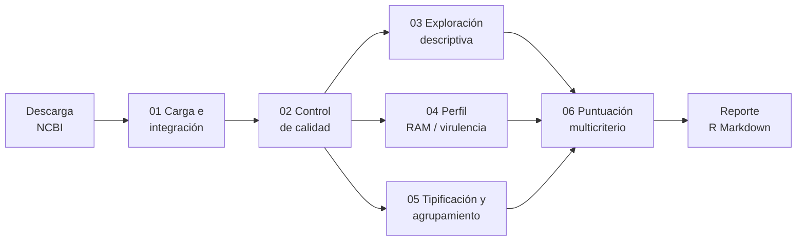
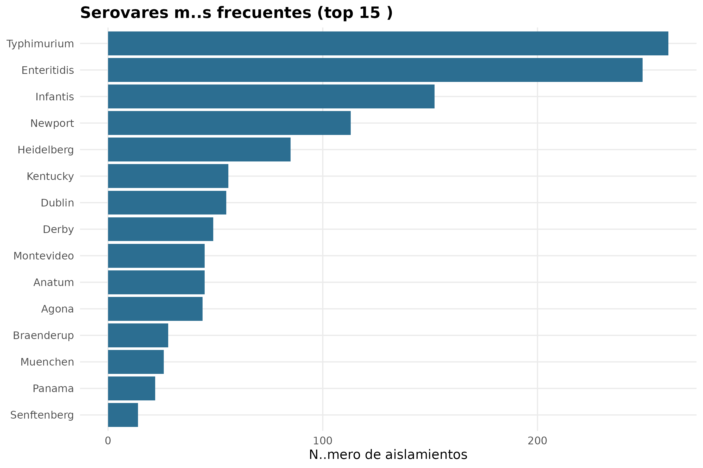
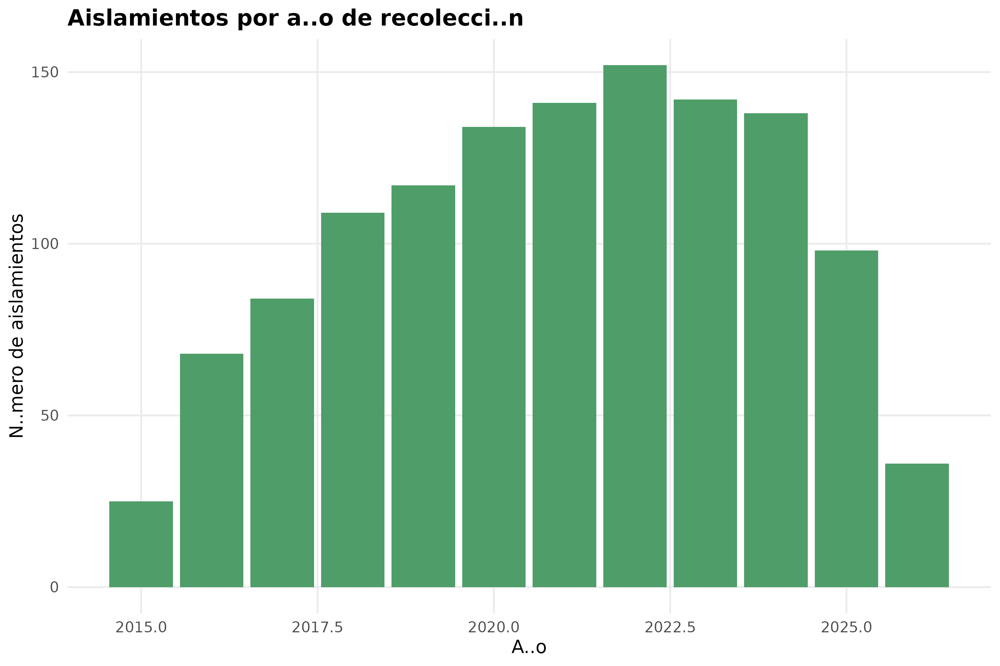
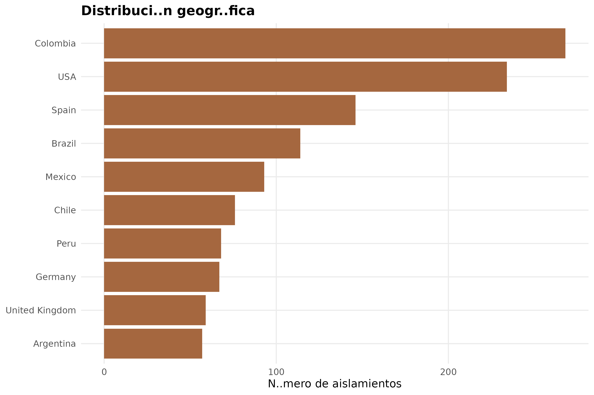
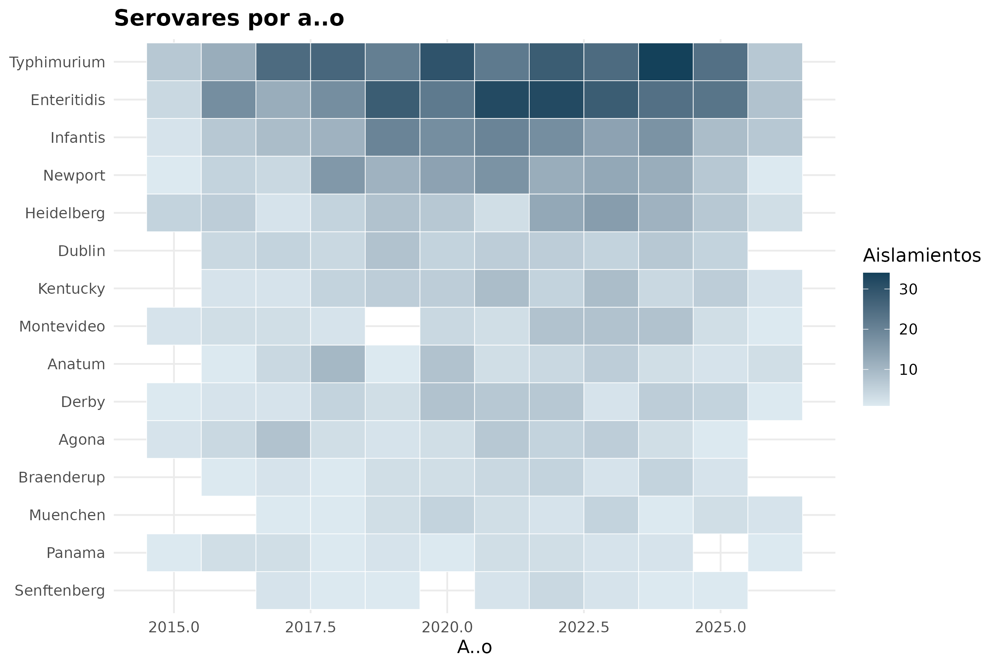

# GeninvA_Salmonella

**Análisis bioinformático para la comparación del gen *invA* entre cepas de *Salmonella enterica***

Proyecto grupal de la asignatura *Introducción a la Programación Científica* (Máster en Bioinformática, UNIR) · Grupo 6


---

## Tabla de contenidos

1. [Descripción](#descripción)
2. [Objetivos](#objetivos)
3. [Fuentes de datos](#fuentes-de-datos)
4. [Estructura del repositorio](#estructura-del-repositorio)
5. [Flujo de análisis](#flujo-de-análisis)
6. [Requisitos e instalación](#requisitos-e-instalación)
7. [Instrucciones de uso](#instrucciones-de-uso)
8. [Resultados principales](#resultados-principales)
9. [Limitaciones](#limitaciones)
10. [Trabajo colaborativo y control de versiones](#trabajo-colaborativo-y-control-de-versiones)
11. [Equipo](#equipo)
12. [Licencia](#licencia)

---

## Descripción

*Salmonella enterica* es uno de los principales agentes de enfermedades transmitidas por alimentos y un reservorio relevante de genes de resistencia a antimicrobianos (RAM). El gen **_invA_** codifica una proteína del sistema de secreción tipo III de la isla de patogenicidad SPI-1. Esta proteína es necesaria para que la bacteria invada las células del hospedador, y el gen se usa mucho como marcador molecular para detectar *Salmonella*.

Este repositorio contiene un **flujo de análisis reproducible en R**. El flujo parte de los metadatos públicos de vigilancia genómica (NCBI Pathogen Detection y NCBI Datasets) y produce:

- la caracterización de la colección de aislamientos: serovares, años, países, fuentes y diversidad;
- el perfil de resistencia y de virulencia que declaran los repositorios;
- el agrupamiento genómico de los aislamientos según su clúster SNP o su secuencia tipo (ST);
- una **propuesta trazable de 20 cepas candidatas**, elegidas con una puntuación multicriterio. Estas cepas forman el panel de referencia para comparar el gen *invA*.

> Todo el análisis usa **datos secundarios ya publicados y anotados** por los repositorios. No se hace ensamblado *de novo* ni se predicen fenotipos nuevos.

## Objetivos

**Objetivo general.** Proponer, con un sistema de puntuación multicriterio reproducible, un conjunto de aislamientos de *S. enterica* ya registrados en bases públicas. Ese conjunto servirá como colección de referencia para la vigilancia y para estudios comparativos del gen *invA*.

**Objetivos específicos**

1. Descargar e integrar los metadatos de aislamientos desde bases de datos públicas, y documentar cómo se hizo.
2. Aplicar un control de calidad trazable: identificadores, duplicados, metadatos mínimos y rango temporal.
3. Describir la composición de la colección (serovares, distribución temporal y geográfica, índices de diversidad).
4. Resumir los determinantes de RAM y de virulencia declarados.
5. Agrupar los aislamientos según la tipificación disponible.
6. Seleccionar las cepas candidatas con criterios explícitos y ponderados, que se pueden cambiar desde un único archivo de configuración.

## Fuentes de datos

| Fuente | Uso en el proyecto | Estado |
|---|---|---|
| [NCBI Pathogen Detection – Isolates Browser](https://www.ncbi.nlm.nih.gov/pathogens/isolates/) | Tabla principal de aislamientos (serovar, país, fuente, clúster SNP, AMR genotypes…) | ✅ Descargada (753 638 registros, 2015–2026) |
| [NCBI Datasets](https://www.ncbi.nlm.nih.gov/datasets/genome/) | Metadatos de ensamblados y BioSamples | ⚠️ Prueba técnica con 10 accesiones |
| [EnteroBase](https://enterobase.warwick.ac.uk/species/index/senterica) | MLST Achtman 7 genes | ❌ Omitida por errores técnicos de la plataforma |

El procedimiento completo de descarga (filtros, columnas seleccionadas y herramientas) está documentado en:

- 📄 [`INSTRUCCIONES_DESCARGA.md`](INSTRUCCIONES_DESCARGA.md): pasos para reproducir la descarga.
- 📄 [`REGISTRO_DESCARGAS.md`](REGISTRO_DESCARGAS.md): fechas, volúmenes, decisiones del equipo y limitaciones.

> Los archivos crudos (`data/raw/`) **no se versionan** por su tamaño, como indica el `.gitignore`. Para reproducir el análisis, descárgalos siguiendo las instrucciones y guárdalos en esa carpeta.

## Estructura del repositorio

```
GeninvA_Salmonella/
├── README.md                    # Este archivo
├── LICENSE                      # GNU GPL v3
├── .gitignore
├── proyecto_salmonella_R.Rproj  # Proyecto de RStudio
├── config.R                     # Parámetros: rutas, filtros, QC, pesos de selección
├── INSTRUCCIONES_DESCARGA.md    # Cómo obtener los datos
├── REGISTRO_DESCARGAS.md        # Bitácora de las descargas
├── data/
│   ├── raw/                     # Datos crudos descargados (no versionados)
│   └── processed/               # Datos procesados (p. ej. assembly_test_clean_unique.tsv)
├── R/                           # Funciones del flujo, una etapa por script
│   ├── 00_setup.R               # Paquetes, carpetas y utilidades comunes
│   ├── 01_carga.R               # Carga e integración de TSV/CSV
│   ├── 02_qc.R                  # Control de calidad y depuración
│   ├── 03_exploracion.R         # Análisis descriptivo y diversidad
│   ├── 04_ram.R                 # Perfil de resistencia y virulencia
│   ├── 05_distancias.R          # Tipificación, distancias y agrupamiento
│   └── 06_seleccion.R           # Puntuación multicriterio y propuesta de cepas
├── scripts/
│   └── run_all.R                # Ejecuta todo el flujo de principio a fin
├── app/
│   └── app.R                    # Interfaz Shiny (prototipo)
├── reporte/
│   └── reporte.Rmd              # Informe final en R Markdown (HTML)
└── resultados/
    ├── README                   # Interpretación detallada de resultados
    ├── figuras/                 # Gráficos generados (PNG)
    └── tablas/                  # Tablas generadas (CSV)
```

## Flujo de análisis



| Etapa | Script | Qué hace |
|---|---|---|
| Configuración | `config.R`, `R/00_setup.R` | Define rutas, filtros y pesos; instala o carga paquetes; crea las carpetas de salida |
| Carga | `R/01_carga.R` | Reconoce los archivos de NCBI Pathogen Detection, EnteroBase y NCBI Datasets; estandariza las columnas con un diccionario de sinónimos y une todo en una tabla |
| Control de calidad | `R/02_qc.R` | Elimina registros sin identificador, duplicados, con metadatos insuficientes o anteriores al año mínimo; guarda un log de trazabilidad |
| Exploración | `R/03_exploracion.R` | Frecuencias por serovar, año, país y fuente; índices de Shannon y Simpson; figuras |
| RAM | `R/04_ram.R` | Expande los campos *AMR genotypes* y *Virulence genotypes* y calcula la prevalencia por serovar |
| Agrupamiento | `R/05_distancias.R` | Asigna un grupo genómico (clúster SNP del NCBI o ST de MLST), calcula distancias entre perfiles de genes y construye un dendrograma |
| Selección | `R/06_seleccion.R` | Puntúa cada aislamiento y elige las cepas candidatas respetando cupos por serovar y por clúster |

### Criterios de selección

Los pesos se definen en `config.R` y deben sumar 1:

| Criterio | Peso |
|---|---|
| Representatividad (serovar y fuente frecuentes) | 0.25 |
| Diversidad genómica | 0.25 |
| Interés en RAM (número de determinantes declarados) | 0.20 |
| Calidad de metadatos | 0.20 |
| Disponibilidad de genoma público | 0.10 |

Restricciones: como máximo **3 cepas por serovar** y **2 por clúster genómico**, para que el panel no se concentre en el linaje más abundante. Semilla: `1234`.

## Requisitos e instalación

- **R ≥ 4.3** (desarrollado con R 4.6.2) y, como recomendación, **RStudio**.
- Paquetes obligatorios: `tidyverse`, `janitor`, `readr`, `stringr`, `scales`, `knitr`, `rmarkdown`.
- Paquetes opcionales: `vegan` (diversidad), `ape` (dendrogramas), `pheatmap` (mapas de calor), `shiny` y `DT` (interfaz).
- Para la descarga de genomas: [NCBI Datasets CLI y Dataformat](https://www.ncbi.nlm.nih.gov/datasets/docs/v2/command-line-tools/download-and-install/).

`R/00_setup.R` instala automáticamente los paquetes que falten.

```bash
git clone https://github.com/MBioInfGrupo6/GeninvA_Salmonella.git
cd GeninvA_Salmonella
```

## Instrucciones de uso

1. **Obtén los datos.** Sigue [`INSTRUCCIONES_DESCARGA.md`](INSTRUCCIONES_DESCARGA.md) y guarda `ncbi_pathogen_isolates.tsv` en `data/raw/`.
2. **Ajusta los parámetros** (opcional) en `config.R`: filtros de país, serovar o año, número de cepas, pesos, etc.
3. **Abre el proyecto** `proyecto_salmonella_R.Rproj` en RStudio, para que el directorio de trabajo sea la raíz del repositorio.
4. **Ejecuta el flujo completo:**

   ```r
   source("scripts/run_all.R")
   ```

   Las tablas se guardan en `resultados/tablas/` y las figuras en `resultados/figuras/`.

5. **Genera el informe:**

   ```r
   rmarkdown::render("reporte/reporte.Rmd")
   ```

6. **Interfaz Shiny** (prototipo):

   ```r
   shiny::runApp("app")
   ```

## Resultados principales

La interpretación completa está en 📄 [`resultados/README`](resultados/README).

**Control de calidad** ([`log_control_calidad.csv`](resultados/tablas/log_control_calidad.csv))

| Etapa | Registros | Eliminados |
|---|---:|---:|
| Entrada | 1 325 | – |
| Sin duplicados | 1 300 | 25 |
| Filtro año ≥ 2015 | 1 244 | 56 |
| **Colección final** | **1 244** | (93,9 % retenido) |

**Composición de la colección**

- 15 serovares. Índice de Shannon = 2,36 y de Simpson = 0,88 ([`indices_diversidad.csv`](resultados/tablas/indices_diversidad.csv)).
- Predominan **Typhimurium** (21,0 %) y **Enteritidis** (20,0 %), seguidos de Infantis, Newport y Heidelberg.
- Los países más representados son Colombia, EE. UU., España, Brasil y México. Los aislamientos aumentan desde 2015 hasta un máximo en 2022.

<p align="center">
  
  
</p>
<p align="center">
  
  
</p>

**Cepas propuestas** ([`cepas_propuestas.csv`](resultados/tablas/cepas_propuestas.csv))

Se proponen **20 aislamientos** de 8 serovares (Infantis, Typhimurium, Enteritidis, Kentucky, Newport, Heidelberg, Dublin y Montevideo) y 8 países, con puntuaciones de 74,3 a 90,5. Todos tienen genoma público disponible. Para cada cepa, la tabla incluye su accesión de ensamblado, su grupo genómico, el número de genes de RAM y de virulencia, y una justificación de por qué fue elegida.

## Limitaciones

- **Sesgo de muestreo:** los países y sectores con más capacidad de secuenciación están sobrerrepresentados. Los resultados describen la colección analizada, no la prevalencia real de cada serovar.
- **Genotipo ≠ fenotipo:** los determinantes de RAM son los que declara el repositorio y no se han confirmado en laboratorio.
- **Fuentes incompletas:** EnteroBase se omitió y NCBI Datasets se usó solo en una prueba con 10 accesiones.
- **Metadatos incompletos** en una parte de los registros.
- La aplicación Shiny es un prototipo y todavía no está conectada al flujo completo.

## Trabajo colaborativo y control de versiones

El proyecto se desarrolló con **Git y GitHub** siguiendo un flujo de ramas por funcionalidad:

- Cada integrante trabajó en una rama propia (`feature/carga`, `feature/qc`, `feature/ram`, `feature/seleccion`…).
- Los cambios se integraron en `main` mediante **pull requests** revisados.
- Los conflictos de fusión se resolvieron en la rama antes de integrarla.
- Se recomienda escribir los mensajes de commit en imperativo y de forma descriptiva, por ejemplo `Añade función de control de calidad`, `Corrige ruta de figuras en reporte`.

## Equipo

**Grupo 6 – Máster en Bioinformática, UNIR**

| Rol | Integrante | Responsabilidad en el proyecto | Archivos principales | GitHub |
|---|---|---|---|---|
| P1 | Claudia Marcela Gutiérrez Villamizar | Coordinación, Git y entrega | Repositorio, `README.md` | [@MBioInfGrupo6](https://github.com/MBioInfGrupo6) |
| P2 | Karla Maciel Navarro Sánchez | Adquisición de datos | `INSTRUCCIONES_DESCARGA.md`, `REGISTRO_DESCARGAS.md`, `data/` | [@macinavarro-hub](https://github.com/macinavarro-hub) |
| P3 | Ruberth Rivera Pérez | Carga, integración e interfaz | `R/00_setup.R`, `R/01_carga.R`, `scripts/run_all.R`, `app/app.R` | [@Ruberth94](https://github.com/Ruberth94) |
| P4 | Laura Pérez Velasco | Calidad y exploración | `R/02_qc.R`, `R/03_exploracion.R`, `resultados/` | [@laurapervel03](https://github.com/laurapervel03) |
| P5 | María Fernanda Chevalier Alba | Resistencia y tipificación | `R/04_ram.R`, `R/05_distancias.R` | [@mfchevalier](https://github.com/mfchevalier) |
| P6 | Kevin Stanley Paz Flores | Selección de cepas e informe | `R/06_seleccion.R`, `config.R`, `reporte/reporte.Rmd` | [@kevinstanleypaz](https://github.com/kevinstanleypaz) |

## Licencia

Este proyecto se distribuye bajo la licencia **GNU General Public License v3.0**. Consulta el archivo [`LICENSE`](LICENSE).
